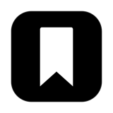
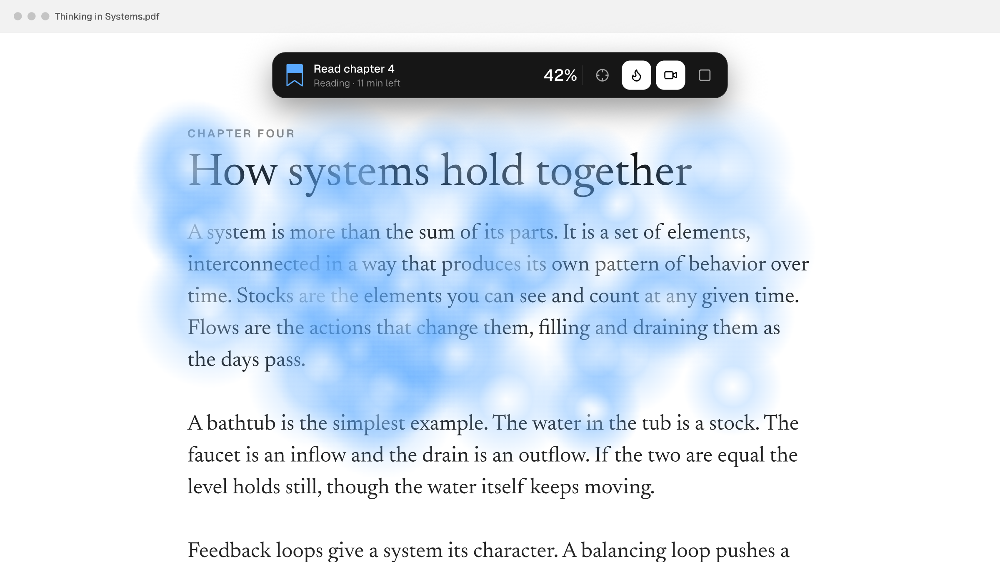
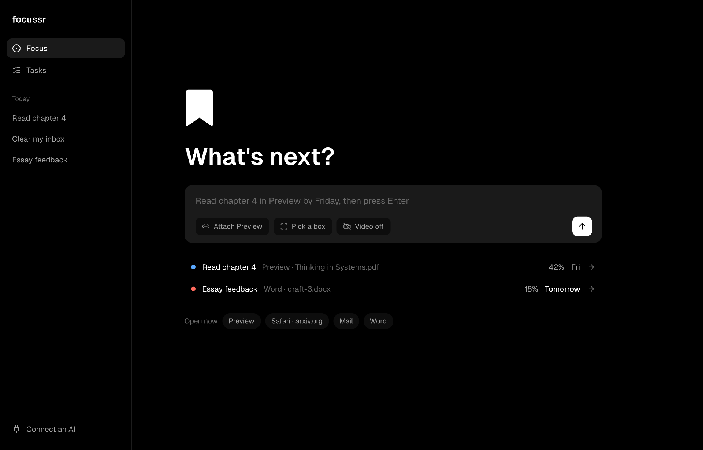
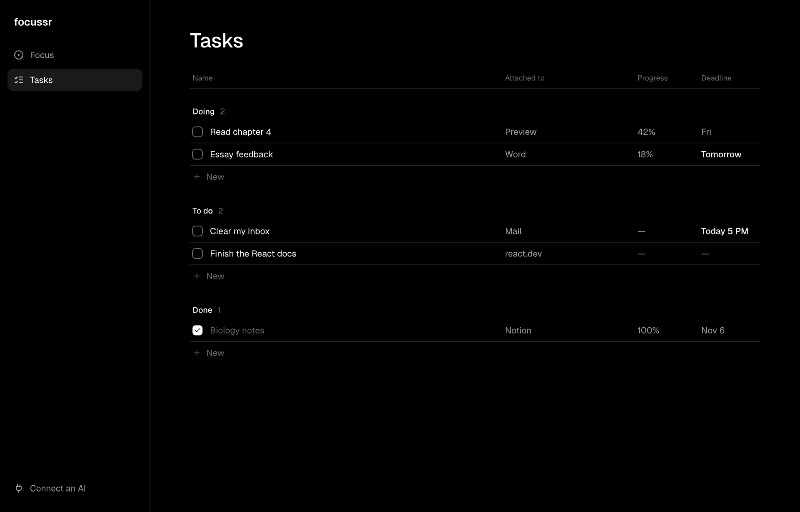

<p align="center">
  
</p>

<h1 align="center">focussr</h1>

<p align="center">
  <strong>Know when you've actually read it.</strong><br />
  A floating bar that attaches to any app or website, ignores skimming, and tells you when you're done.
</p>

<p align="center">
  
  
  
  <a href="LICENSE"></a>
</p>

<p align="center">
  
</p>
<p align="center"><sub>Design render from <code>design/focussr.pen</code>.</sub></p>

You don't read inside Focussr. You read wherever you already read, in Word, Preview, Mail or a browser,
and Focussr sits on top like a Zoom bar.

Scroll slowly through a document and the ribbon fills. Flick through it and nothing counts.

## What it does

- **Attaches to anything.** A whole app, a website, or one pane on the screen.
- **Knows skimming from reading.** Fast scrolling earns no progress at all.
- **Tells you when you're done,** and forecasts how long is left at your pace.
- **Remembers your place.** Open the same document again and it picks up where you stopped.
- **Builds a real heat map.** With video on, attention is painted over screenshots of your actual content.
- **Keeps a task list** with deadlines, in plain English like "friday 5pm".
- **Works with any AI.** Connect any assistant that speaks [MCP](https://modelcontextprotocol.io).
- **Stays on your computer.** No account, no server, and video is never saved.

<table>
  <tr>
    <td></td>
    <td></td>
  </tr>
  <tr>
    <td align="center"><sub>Press Enter and it's tracking</sub></td>
    <td align="center"><sub>Tasks and deadlines</sub></td>
  </tr>
</table>

## Get started

### Download

Grab the latest build from [Releases](https://github.com/chheangg/focussr/releases).

The macOS build isn't notarized yet, so macOS will block it on first launch. After dragging it to
Applications, run this once:

```sh
xattr -cr /Applications/Focussr.app
```

### Run from source

You need Node 22 or newer. On macOS you also need the Xcode command line tools, for the sensor.

```sh
git clone https://github.com/chheangg/focussr.git
cd focussr
npm install
npm run dev
```

macOS asks for **Accessibility** so Focussr can follow scrolling. If you turn on video, it also asks for
**Camera** and **Screen Recording**.

## How to use it

1. Type what you're doing and press Enter, or click anything under **Open now**.
2. Read in your own app. The bar stays on top of it, and you can drag it out of the way.
3. Use the bar's buttons to show where it's attached, paint the heat map on the page, or switch video.

To attach to only part of a window, use **Pick a box** and click it.

### What counts as reading

| You're... | Ribbon says | Counts? |
| --- | --- | --- |
| Reading or scrolling slowly | Reading | Yes |
| Scrolling fast | Skimming | No |
| In another app or tab | Away | No |
| Not touching anything for 90 seconds | Idle | No, unless video sees your eyes |

The details are in [docs/MVP.md](docs/MVP.md#how-read-is-calculated).

## Connect an AI

Focussr works with whichever assistant you already use. Turn on **Connect an AI** in the app, then paste
the config it shows into your MCP client. It's off by default and only reachable from your own account
on your computer.

| Tool | What it does |
| --- | --- |
| `list_tasks`, `add_task` | Read and add tasks, with deadlines |
| `start_focus`, `focus_status`, `end_focus` | Run a session and read progress |
| `list_open_apps` | See what's open |
| `find_files` | Find files by name in your home folder. Paths only, never contents |
| `open_item` | Open a file or link, or switch to an app. Won't open programs or scripts |
| `find_on_screen` | Find text in the window and scroll to it |
| `read_screen` | Read the visible text of the front window |

So you can tell your assistant "find my biology notes and take me to the section on enzymes."

`read_screen` passes page text to whichever AI you connected. Only connect one you trust with what's on
your screen.

For the optional **Ask** box, Focussr uses any local model with an OpenAI-compatible API, such as
Ollama or LM Studio. Without one it answers from your session numbers.

## Privacy

- **No network.** The app makes no requests of its own, and the optional model call only goes to your
  own machine.
- **Video is never saved or sent.** Frames are analysed in memory and dropped.
- **Screenshots stay local.** They're only taken with video on, and they go when you delete the task.

[docs/ARCHITECTURE.md](docs/ARCHITECTURE.md#where-data-goes) lists every file Focussr writes.

## Platform support

| | macOS | Windows | Linux |
| --- | --- | --- | --- |
| Task list and deadlines | ✅ | ✅ | ✅ |
| Focused-time tracking | ✅ | ✅ | ✅ |
| Attach to apps and websites | ✅ | Planned | Planned |
| Scroll tracking and skim detection | ✅ | Planned | Planned |
| Heat map | ✅ | Planned | Planned |

## Contributing

Contributions are very welcome, and a new platform is the most useful one. A port is one small program
that speaks a [simple JSON protocol](docs/ARCHITECTURE.md#the-sensor-protocol).

Start with [CONTRIBUTING.md](CONTRIBUTING.md), or pick up a
[good first issue](https://github.com/chheangg/focussr/issues?q=is%3Aissue+is%3Aopen+label%3A%22good+first+issue%22).

## License

[MIT](LICENSE)
